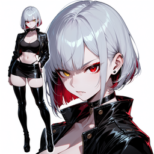

# WaifuStudio v2.0 — Estudio local de producción anime

<p align="center">
  
</p>

[](https://github.com/gusnion/WaifuStudio)
[](https://opensource.org/licenses/MIT)
[](https://www.nvidia.com)
[](https://github.com/comfyanonymous/ComfyUI)
[]()
[](https://www.patreon.com/gusnion)

> [English](README.md) | Español | [日本語](README.ja.md) | [中文](README.zh.md) | [Русский](README.ru.md)

WaifuStudio es un espacio de producción local para imágenes anime y vídeo corto. Reúne generación de imágenes, referencias de personaje, generación de vídeo, edición, escalado, montaje en Timeline y gestión de galería en una sola interfaz web, con ComfyUI como motor de inferencia.

## Idiomas

La interfaz está disponible en **inglés (por defecto)**, **español**, **japonés**, **chino simplificado** y **ruso**. Usa el botón del globo en la barra superior para cambiar. Los nombres técnicos de modelos, los ejemplos de prompts, el contenido del usuario y algunos mensajes de error del backend permanecen en su idioma original.

La aplicación está pensada para una única GPU NVIDIA y un escritorio Windows. No requiere cuenta, servicio en la nube ni telemetría. El instalador mantiene Python, ComfyUI y FFmpeg en una carpeta portable.

> [!WARNING]
> **Estado y alcance**: proyecto independiente, entregado "tal cual", sin garantías. Está desarrollado y probado sobre la configuración de referencia. Otras GPUs, sistemas y flujos pueden funcionar, pero no están validados oficialmente. Puede haber asperezas; mantén copias de proyectos y medios generados.

## Qué incluye

| Módulo | Estado | Qué hace |
|---|---|---|
| **Instalador Windows** | Disponible | Prepara Python portable, ComfyUI, nodos, modelos, FFmpeg/FFprobe y el acceso directo de la app. |
| **Imagen y OC Maker** | Disponible | Anima 2.9B y SDXL/Illustrious, zonas de prompt, LoRAs, perfiles de personaje, referencias y entrenamiento opcional de LoRA. |
| **Asistente de prompts** | Disponible | Índice local de tags Danbooru y LLM opcional en CPU para expandir prompts y describir imágenes. |
| **Vídeo H3** | Disponible | Generación en 8 pasos con VideoDeltaNet en modos I2V, FLF2V, Ref2VA y V2V, audio nativo y plantillas de prompt cortas. |
| **Editor** | Disponible | Edición por instrucción con Qwen-Image 2.1, hasta diez referencias y presets de pose L0–L3. El inpainting con máscara no forma parte de esta versión. |
| **Timeline** | Disponible | Ordena clips e imágenes, ajusta duración, aplica fade/zoom, silencia clips, añade audio externo, continúa con I2V/FLF2V y exporta MP4. Es un secuenciador enfocado, no un NLE completo. |
| **Upscaler** | Disponible | Escalado de imagen con GAN, Hires Fix y Qwen Remaster, nitidez RCAS/Adaptive USM e interpolación RIFE. El escalado de vídeo está limitado a 300 frames por trabajo. |
| **Galería y cola** | Disponible | Galería sobre SQLite, historial de trabajos y cola FIFO de una sola GPU compartida por todas las pestañas. |

## Instalación (Windows)

### Antes de empezar

- Windows 10/11 de 64 bits.
- GPU NVIDIA; el equipo de referencia usa una RTX 3060 de 12 GB.
- Driver NVIDIA 570 o superior (el stack usa CUDA 13).
- Git para Windows si quieres actualizaciones automáticas. La instalación ZIP funciona sin Git.
- Espacio libre suficiente para los modelos. El instalador muestra el tamaño y pregunta antes de descargar.
- Mejor una ruta local corta que una carpeta sincronizada, por ejemplo `C:\AI\WaifuStudio`.
- Si tienes una copia anterior en ejecución, deténla con `stop.bat`.

### Opción A: clonar con Git (recomendado)

1. Clona el repositorio:

```powershell
git clone https://github.com/gusnion/WaifuStudio.git
cd WaifuStudio
```

2. Instala:

```powershell
install.bat
```

El instalador crea el entorno aislado de Python, ComfyUI, los nodos, FFmpeg y el acceso directo. También pregunta qué modelos descargar. Se puede volver a ejecutar: verifica lo que ya existe y solo instala lo que falta.

3. Arranca la app:

```powershell
start.bat
```

Abre `http://127.0.0.1:8765` en una ventana dedicada.

4. Detén o diagnostica:

```powershell
stop.bat
healthcheck.bat
```

Si los modelos ya están en disco y solo necesitas el engine y la app:

```powershell
install.bat -SkipModels
```

No uses `-SkipModels` en una primera instalación si todavía necesitas los modelos recomendados.

### Opción B: ZIP

1. Descarga el ZIP y extráelo en una carpeta nueva. No lo extraigas encima de una instalación vieja.
2. Ejecuta `install.bat` dentro de la carpeta nueva.
3. Ejecuta `start.bat`.
4. Sigue usando esa carpeta. Las instalaciones ZIP no tienen metadatos de Git, así que `update.bat` no puede actualizarlas.

### Comandos

```text
start.bat        arranca app y engine
stop.bat         detiene app y engine
update.bat       actualiza una instalación Git
healthcheck.bat  comprueba rutas y servicios
start_engine.bat arranca solo ComfyUI
stop_engine.bat  detiene solo ComfyUI
```

FFmpeg se instala por defecto. `-SkipFfmpeg` existe para instalaciones mínimas, pero el export y la concatenación del Timeline no funcionarán. `install.bat` también crea `WAIFUSTUDIO.lnk` con el icono de la app; si mueves la carpeta, ejecuta `scripts\create_shortcut.ps1` o vuelve a ejecutar el instalador.

## Actualización

### Instalación Git

`update.bat` detiene la app, guarda `data/` y `ComfyUI/user/` en `%LOCALAPPDATA%\WaifuStudio\backups\update-<fecha>`, ejecuta `git pull --ff-only`, vuelve a ejecutar el instalador y arranca la app.

Antes de actualizar:

- Termina o cancela los jobs activos de ComfyUI.
- Si `git status --short` muestra cambios versionados, guárdalos o haz commit. El actualizador se niega a pisarlos.

Actualización normal:

```powershell
update.bat
```

Comprobar primero sin cambiar nada:

```powershell
update.bat -DryRun
```

Variantes útiles:

```powershell
update.bat -NoStart        # actualiza sin abrir la app
update.bat -InstallModels  # descarga también los modelos que falten
```

Por defecto no descarga modelos nuevos. Se niega a ejecutarse si hay cambios locales versionados, si la rama actual no es `main` o si ComfyUI tiene jobs activos. `install.bat -Update` es un alias de `update.bat`.

### Instalación ZIP

No hay actualizador en el sitio para ZIP. Actualiza a mano:

1. Detén la app con `stop.bat`.
2. Haz backup de `data/`, `ComfyUI/user/`, `.env` y `config.local.json` si existen. Incluye también `ComfyUI/models/` salvo que vayas a descargar los modelos otra vez.
3. Extrae el ZIP nuevo en una carpeta nueva.
4. Copia `data/`, `ComfyUI/user/` y, si los conservaste, `ComfyUI/models/` de la carpeta vieja a la nueva.
5. Ejecuta `install.bat` en la carpeta nueva.
6. Arranca y verifica la galería y los proyectos antes de borrar la carpeta vieja.

El actualizador de Git deja un backup con fecha. Consérvalo hasta probar la versión nueva.

El icono actual es provisional. La fuente es `waifystudioicon.ico`; la app sirve `static/favicon.ico` y el README usa `static/waifustudio-icon.png`.

## Añadir modelos de imagen y LoRAs

El repositorio no incluye checkpoints ni LoRAs de terceros. El instalador descarga el set inicial; los archivos adicionales se copian a mano. Todavía no hay navegador de modelos dentro de la app.

### Dónde va cada archivo

| Recurso | Carpeta | Formato | Notas |
|---|---|---|---|
| Checkpoint SDXL | `ComfyUI/models/checkpoints/` | `.safetensors` | Incluye CLIP y VAE. Illustrious, Pony y los SDXL estilo NoobAI usan esta ruta. |
| UNET Anima 2.9B | `ComfyUI/models/diffusion_models/` | `.safetensors` | Necesita el text encoder y el VAE de Anima indicados abajo. |
| LoRA Anima | `ComfyUI/models/loras/anima/` | `.safetensors` | La subcarpeta es opcional, pero ayuda a detectar la familia. |
| LoRA SDXL | `ComfyUI/models/loras/sdxl/` | `.safetensors` | Solo con checkpoints SDXL/Illustrious. |
| Text encoder Anima | `ComfyUI/models/text_encoders/` | `.safetensors` | Nombre esperado: `qwen_3_06b_base.safetensors`. |
| VAE Anima | `ComfyUI/models/vae/` | `.safetensors` | Nombre esperado: `qwen_image_vae.safetensors`. |

Usa `.safetensors`. El escáner automático solo registra archivos `.safetensors`; los `.ckpt` y `.pt` no se detectan.

### Descargar e instalar

1. Descarga el modelo desde su página oficial, normalmente Civitai o Hugging Face.
   - En Civitai usa la descarga **Model** o **LoRA**, no el workflow, la preview ni los datos de entrenamiento.
   - En Hugging Face entra en **Files and versions** y descarga el `.safetensors`.
   - Los modelos con age-gate requieren cuenta y aceptar sus términos.
2. Copia el archivo en la carpeta que corresponda según la tabla.
3. Si usas Anima, no cambies los nombres del text encoder ni del VAE.
4. Abre la app y pulsa **Recargar** en la pestaña Imagen, o llama a `GET /api/models?scan=1`.
5. Abre **Elegir LoRAs → Gestionar biblioteca** para registrar una LoRA, o deja que el escáner la encuentre con `POST /api/loras/scan`.
6. Selecciona el modelo y genera una imagen pequeña de prueba antes de usarlo en un proyecto.

Las subcarpetas se escanean de forma recursiva. Organizar las LoRAs como `loras/anima/...` y `loras/sdxl/...` es opcional, pero ayuda cuando los metadatos del archivo no identifican la familia.

### Familias de imagen compatibles

| Familia | Compatible | Notas |
|---|---|---|
| **Anima 2.9B** | Sí | La familia nativa principal. Los modelos de 28 bloques son el objetivo seguro. Existen variantes de 40 bloques, pero no todas las LoRAs de 28 se transfieren bien. |
| **SDXL** | Sí | Checkpoint con su propio CLIP y VAE. |
| **Illustrious** | Sí | Arquitectura SDXL; se trata como checkpoint SDXL. |
| **Pony** | Sí | Arquitectura SDXL; las convenciones de prompt son distintas. |
| **SDXL estilo NoobAI** | Sí | Arquitectura SDXL; las convenciones de prompt son distintas. |
| **SD 1.5 / SD 2.1** | No | Sin validar; la app asume loaders y valores de SDXL. |
| **Flux, Qwen-Image y otras arquitecturas** | No | La pestaña Imagen está hecha para Anima y SDXL. Qwen-Image pertenece al Editor, no a esta pestaña. |

### LoRAs compatibles

- **LoRA Anima** con un UNET Anima.
- **LoRA SDXL/Illustrious/Pony** con un checkpoint SDXL.
- No mezcles familias. Una LoRA entrenada para Anima no funciona bien en SDXL, y al contrario.
- Las LoRAs de H3 y Wan son para vídeo, no para la pestaña Imagen.
- La app intenta leer el trigger de los metadatos de la LoRA. Si falta, escríbelo a mano en la biblioteca.
- Empieza con un peso de `0.6–0.8` para estilo y `0.8–1.0` para personaje. Ajusta desde ahí.

### Lo que no se añade desde esta pantalla

- ControlNet, IP-Adapter, textual inversion y embeddings no están expuestos en la pestaña Imagen.
- No hay selector de VAE separado; Anima usa su par fijo de encoder/VAE, y los checkpoints SDXL llevan el suyo.
- Los upscalers son un catálogo aparte y fijo. Copiar un `.pth` nuevo en `upscale_models` no lo añade al desplegable del Upscaler.
- Los modelos y presets de vídeo H3 no se instalan dejando archivos en `checkpoints`.

Revisa la licencia de cada modelo antes de publicar trabajos generados. Los modelos Anima son no comerciales; SDXL y los modelos de Civitai tienen sus propios términos.

## Configuración de referencia

Este es el hardware y software usado para desarrollo y validación. No son requisitos mínimos.

| Componente | Referencia |
|---|---|
| GPU | NVIDIA GeForce RTX 3060, 12 GB |
| CPU | AMD Ryzen 7 5700X, 8 núcleos |
| RAM | 32 GB DDR4 |
| SO | Windows 10 64 bits |
| Motor | ComfyUI v0.37.4 |
| Python | CPython 3.12.12, aislado |
| Inferencia | PyTorch 2.11.0 + CUDA 13.0 |

Los flujos están ajustados a un presupuesto de 12 GB y un trabajo a la vez. El asistente opcional Qwen3.5-9B se ejecuta en CPU para no quitar VRAM a ComfyUI.

Windows es la ruta de instalación soportada. El núcleo es FastAPI, ComfyUI y JavaScript sin bundler; el modo servidor Linux/LAN está planificado, pero todavía no está disponible.

## Límites actuales

- Una sola GPU y cola FIFO. Los trabajos largos bloquean las demás pestañas hasta terminar.
- H3 genera segmentos cortos: 15 segundos por generación, con encadenado donde esté soportado.
- El upscaler nativo de vídeo procesa un batch y rechaza más de 300 frames. Los vídeos largos necesitan una herramienta externa.
- El Timeline es pequeño a propósito: todavía no tiene playhead, trim, drag-and-drop ni forma de onda.
- No hay lip-sync ni voz en off automática en esta versión.
- No hay inferencia en nube, alquiler de GPU remota ni market de modelos integrados.
- La Guía interna está en revisión; el README y la UI real son la referencia de lo que existe.

## Hoja de ruta

Lo siguiente está planificado o en evaluación. No son promesas, no tienen fechas y no está disponible salvo que se indique.

### Corto plazo

- **Presets de modelos por VRAM** y gestor de modelos verificado, para no asumir 12 GB.
- **Modo Estudio Linux**: servidor headless para la red local, separado de la app personal de Windows.
- **Soporte de ComfyUI/GPU remota** con volúmenes persistentes de modelos, para no depender de la GPU local.
- **Herramientas para agentes locales**: CLI, skill y modo DSH que manejen la app mediante su API.
- **Cola de escenas en Timeline** y director de guion a escenas con trabajos reanudables.

### En evaluación

- **Narración con Chatterbox** para voz en español, con lip-sync opcional como paso separado.
- **Integración de Video2X** para escalar vídeo largo, mantenido como herramienta externa.
- **Perfiles Wan 2.2**, incluido el banco de workflows comunitario acreditado a Artelive.
- **Navegador/descargador de Civitai**, sujeto a límites de API, licencias y contenido con edad.
- **LTX 2.5**: evaluado, pero no práctico en una GPU de 12 GB en su forma actual.
- **Mejoras NLE del Timeline**: playhead, recorte, drag-and-drop y formas de onda.

## Desarrollo

La versión 2.0 es una pasada de estabilización y documentación sobre la aplicación original. La remediación, el trabajo de tests y las bases para agentes fueron continuados con **DeepSeek V4.1 Flash 1017** usando **DSH**.

La suite offline ejecuta actualmente 1.613 tests. El README describe la app tal como está; lo que solo está planificado aparece en la hoja de ruta.

## Apoyo

El desarrollo es independiente y la aplicación sigue bajo licencia MIT. Si quieres apoyar el tiempo dedicado a pruebas, documentación y mantenimiento, hay una página de Patreon:

https://www.patreon.com/gusnion

El apoyo es opcional y no desbloquea ni restringe ninguna parte de la aplicación.

## Licencia y créditos

- Distribuido bajo la **Licencia MIT**. Sin garantías.
- Construido sobre ComfyUI, MiniMax H3 VDN, Anima, Qwen y FFmpeg.
- **Investigación de workflows Wan 2.2 y banco para 8 GB**: Artelive (contribución comunitaria; integración pendiente).
